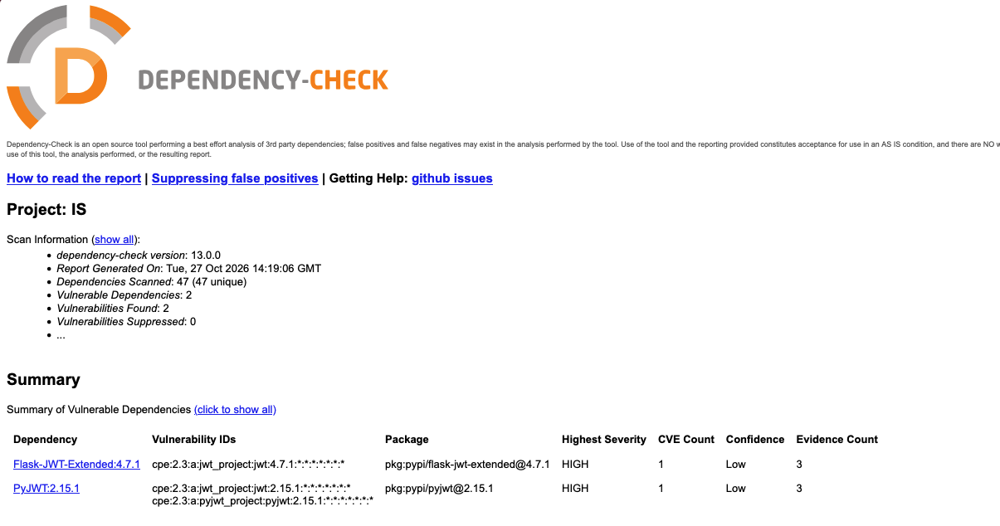
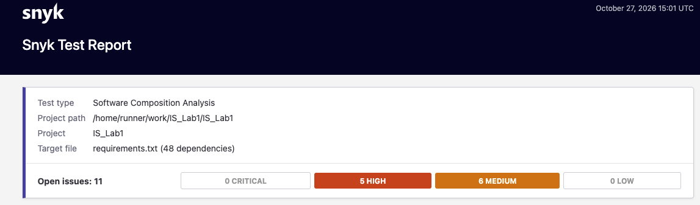
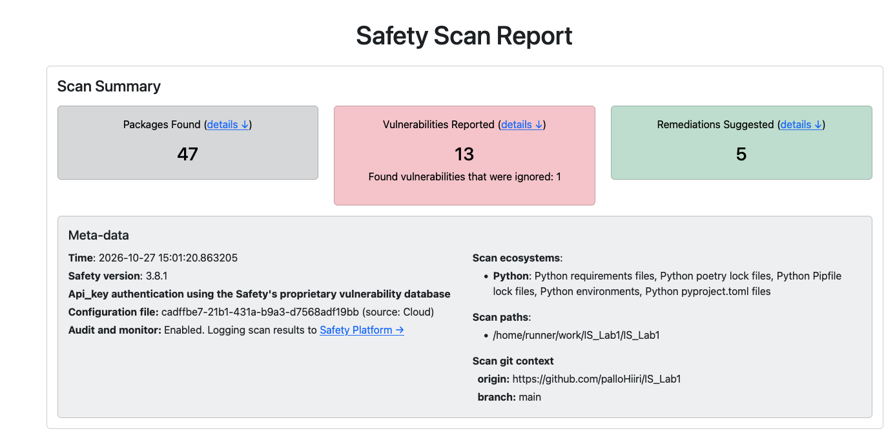
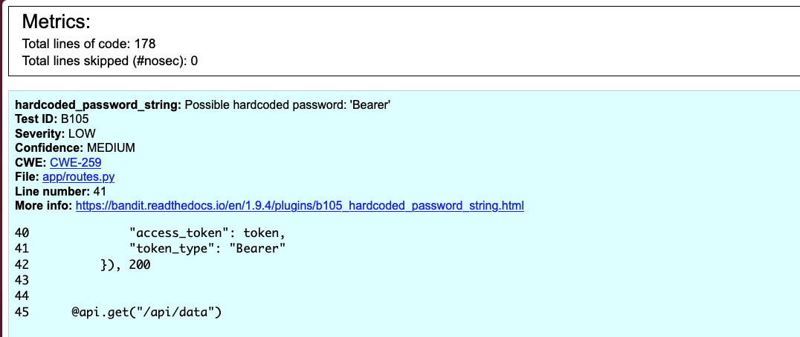
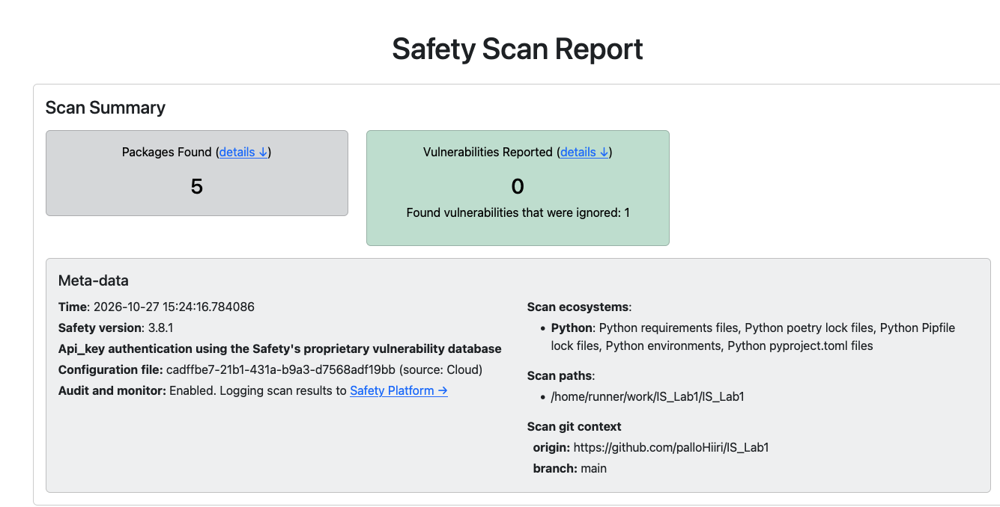
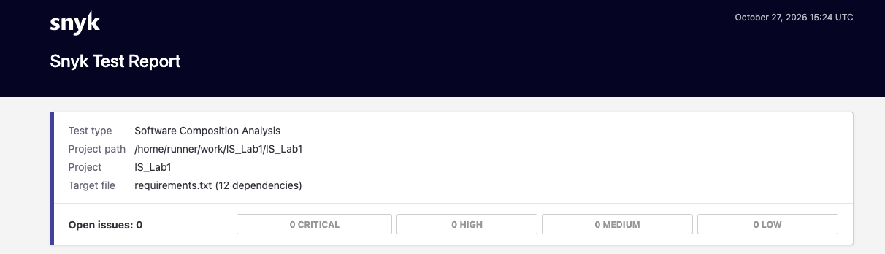
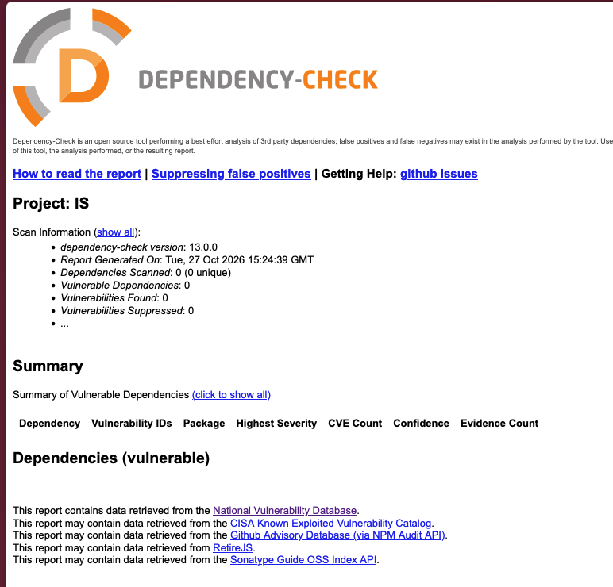
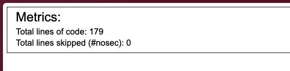

# Информационная безопасность. Работа 1: Разработка защищённого REST API с интеграцией в CI/CD

**Стек:** Python 3.12, Flask, SQLite, Flask-JWT-Extended, Flask-Bcrypt.

**Инструменты безопасности:** Bandit (SAST), Safety, Snyk, OWASP Dependency-Check (SCA).

## Описание проекта

Разработано защищённое REST API для хранения пользовательских заметок. Приложение использует аутентификацию на основе JWT, хранение паролей в виде bcrypt-хэшей и базу данных SQLite.

### API

Приложение предоставляет три эндпоинта:

1. `POST /auth/login` — аутентификация пользователя и выдача JWT-токена.
2. `GET /api/data` — получение заметок авторизованного пользователя.
3. `POST /api/data` — создание новой заметки авторизованным пользователем.

### Примеры запросов

#### POST /auth/login

Тело запроса:

```json
{
  "username": "test",
  "password": "test"
}
```

Ответ:

```json
{
  "access_token": "<jwt-token>",
  "token_type": "Bearer"
}
```

При неверных учётных данных возвращается `401 Unauthorized`.

#### GET /api/data

Для получения данных необходимо передать JWT в заголовке:

```http
Authorization: Bearer <jwt-token>
```

Ответ:

```json
{
  "notes": [
    {
      "id": 1,
      "title": "First note",
      "content": "Secure API works!"
    }
  ]
}
```

При отсутствии или недействительности токена доступ запрещается.

#### POST /api/data

Заголовки:

```http
Authorization: Bearer <jwt-token>
Content-Type: application/json
```

Тело запроса:

```json
{
  "title": "XSS Test",
  "content": "<script>alert(1)</script>"
}
```

Ответ (`201 Created`):

```json
{
  "id": 2,
  "title": "XSS Test",
  "content": "&lt;script&gt;alert(1)&lt;/script&gt;"
}
```

### Запуск приложения

Создать виртуальное окружение и установить зависимости:

```bash
python3.12 -m venv .venv
source .venv/bin/activate
pip install -r requirements.txt
```

Создать файл `.env` на основе `.env.example` и указать секретный ключ:

```dotenv
JWT_SECRET_KEY=<secret-key>
```

Для генерации ключа:

```bash
python -c "import secrets; print(secrets.token_hex(32))"
```

Запустить сервер:

```bash
python run.py
```

API будет доступно по адресу `http://127.0.0.1:5000`.

При первом запуске автоматически создаются таблицы `users` и `notes` в базе SQLite.

## Реализованные меры защиты

- **SQL Injection:** все запросы к SQLite выполняются с использованием параметризованных выражений (`?`). Конкатенация пользовательского ввода с SQL-запросами отсутствует.
- **XSS:** пользовательские данные экранируются функцией `html.escape()` перед возвращением в ответах API. Ответы передаются в формате JSON.
- **Аутентификация:** пароли хранятся в виде bcrypt-хэшей. После успешной авторизации выдаётся подписанный JWT со сроком действия один час.
- **Контроль доступа:** защищённые эндпоинты используют `@jwt_required()`. Идентификатор пользователя извлекается из проверенного JWT, что предотвращает доступ к заметкам других пользователей через подмену идентификатора в запросе.
- **Валидация:** проверяются типы пользовательских данных, наличие обязательных полей и ограничения длины заметок.
- **Защита секретов:** ключ подписи JWT хранится в `.env`, исключённом из Git через `.gitignore`.

## CI/CD и автоматизированный анализ безопасности

В проекте настроен GitHub Actions pipeline, конфигурация которого находится в `.github/workflows/ci.yml`.

Pipeline запускается автоматически при каждом `push` и создании `pull request`, а также вручную.

Используются четыре инструмента:

1. **Bandit (SAST)** — статический анализ исходного Python-кода.
2. **Safety (SCA)** — поиск известных уязвимостей в Python-зависимостях.
3. **Snyk (SCA)** — анализ зависимостей и определение известных уязвимостей.
4. **OWASP Dependency-Check (SCA)** — дополнительная проверка сторонних компонентов по базам известных уязвимостей.

По результатам работы формируются HTML-отчёты, которые сохраняются в артефакте `security-reports`.

## Результаты сканирования

### Первоначальные проверки

При первоначальном запуске анализаторов были обнаружены потенциальные проблемы в исходном коде и сторонних зависимостях.

#### OWASP Dependency-Check

Сканер обнаружил две уязвимости уровня HIGH для `Flask-JWT-Extended` и `PyJWT`, связанные с `CVE-2025-45770`.

Анализ показал, что OWASP ошибочно сопоставил используемые Python-библиотеки с другой библиотекой `lcobucci/jwt` для PHP.

Библиотека `Flask-JWT-Extended` была обновлена с версии 4.7.1 до 4.7.4, однако ложноположительные срабатывания сохранились. Для устранения проблемы экспериментальные анализаторы OWASP были отключены, а проверка Python-зависимостей оставлена инструментам Safety и Snyk.



#### Snyk

При первоначальном сканировании Snyk обнаружил 11 уязвимостей в сторонних зависимостях проекта, включая проблемы уровней HIGH и MEDIUM.

Основной причиной стало наличие устаревших пакетов и зависимостей инструментов разработки в `requirements.txt`.



#### Safety

Safety обнаружил 13 уязвимостей в Python-зависимостях, включая проблемы в пакетах `msgpack`, `filelock`, `urllib3`, `requests` и других.

Часть обнаруженных зависимостей относилась к инструментам разработки и не требовалась для работы REST API.



#### Bandit

Bandit обнаружил предупреждение `B105` (Possible hardcoded password) для значения `"Bearer"`.

Данное значение является стандартным обозначением типа токена авторизации, а не паролем. Срабатывание было классифицировано как ложноположительное.

Для исправления строка была вынесена в константу. 



### Исправление обнаруженных проблем

Первоначально файл `requirements.txt` был создан командой `pip freeze`, поэтому содержал все установленные пакеты, включая библиотеки для тестирования и анализа безопасности.

В ходе исправления были выполнены следующие действия:

- Обновлена библиотека `Flask-JWT-Extended`.
- Обновлены необходимые зависимости приложения до совместимых исправленных версий.
- Исключены ненужные для работы REST API зависимости инструментов разработки.
- Исправлено ложноположительное срабатывание Bandit B105.
- Обновлена конфигурация GitHub Actions.
- Проведено повторное сканирование исходного кода и зависимостей.


### Результаты повторного сканирования

После внесения исправлений был повторно запущен pipeline со всеми четырьмя инструментами безопасности.

#### Safety

Повторная проверка Safety завершилась успешно. Ранее обнаруженные уязвимости в анализируемых зависимостях устранены.



#### Snyk

Повторное сканирование Snyk завершилось успешно. Известных уязвимостей в проверяемых зависимостях приложения не обнаружено.



#### OWASP Dependency-Check

OWASP Dependency-Check завершил сканирование без ошибок. Ложноположительные результаты для JWT-библиотек больше не возникают.

Экспериментальные анализаторы Python-зависимостей отключены, поэтому данный результат не рассматривается как самостоятельное подтверждение отсутствия уязвимостей в Python-пакетах.



#### Bandit

Повторный статический анализ Bandit завершился успешно. Потенциально опасных конструкций в проверяемом Python-коде не обнаружено.



### Итоговый результат CI/CD

После исправлений все четыре этапа сканирования завершились успешно.


